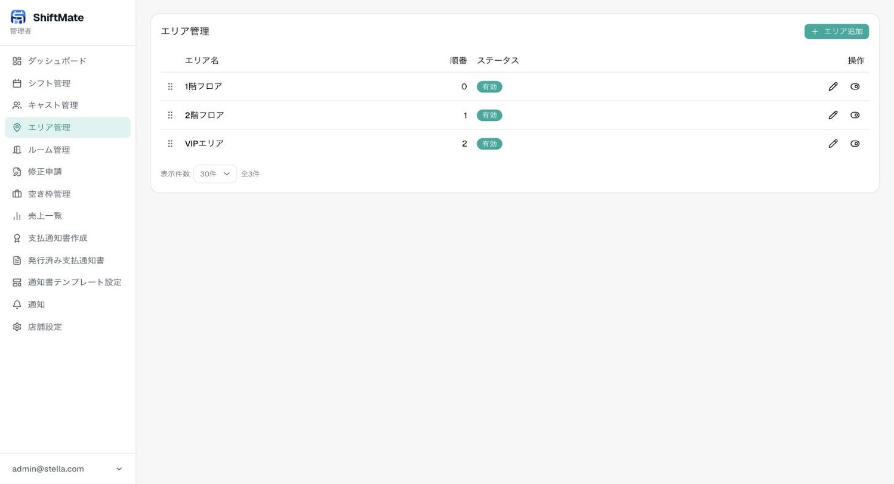
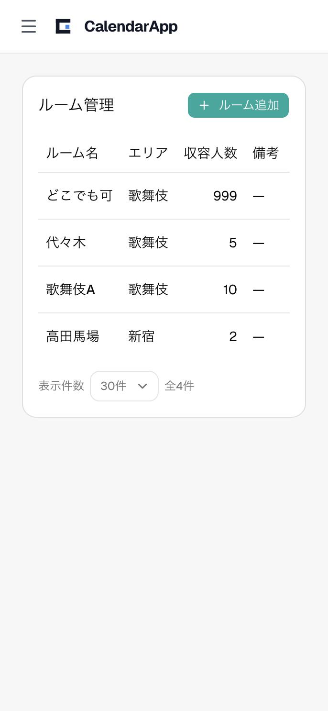
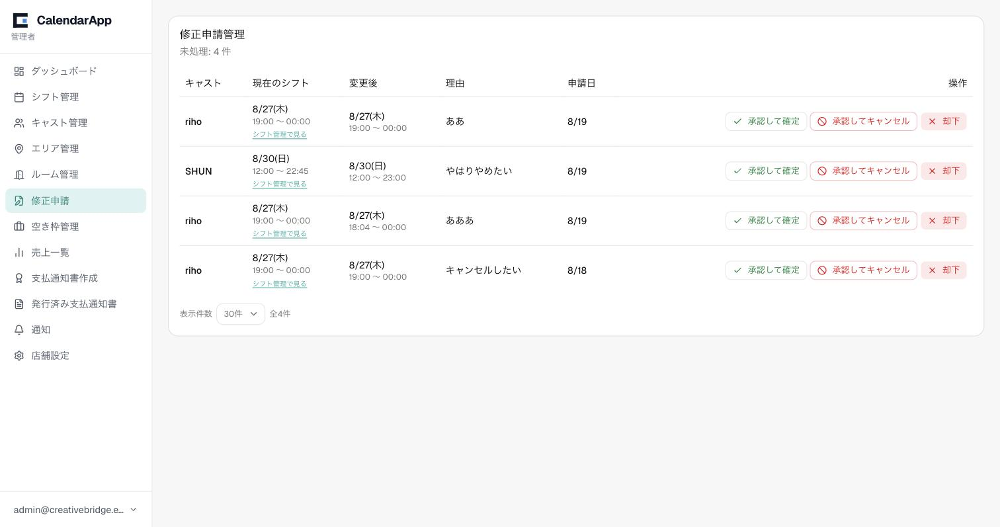
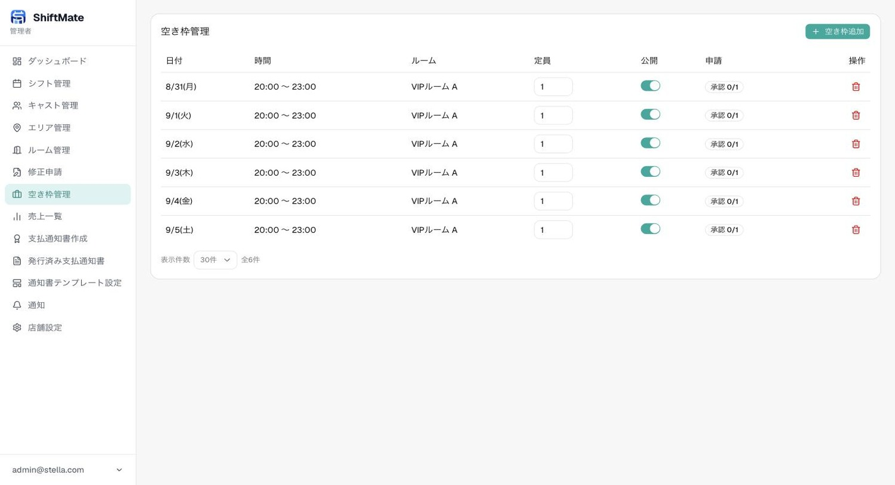
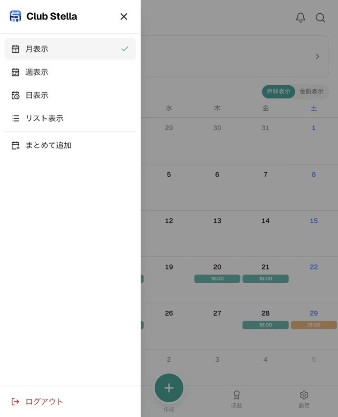
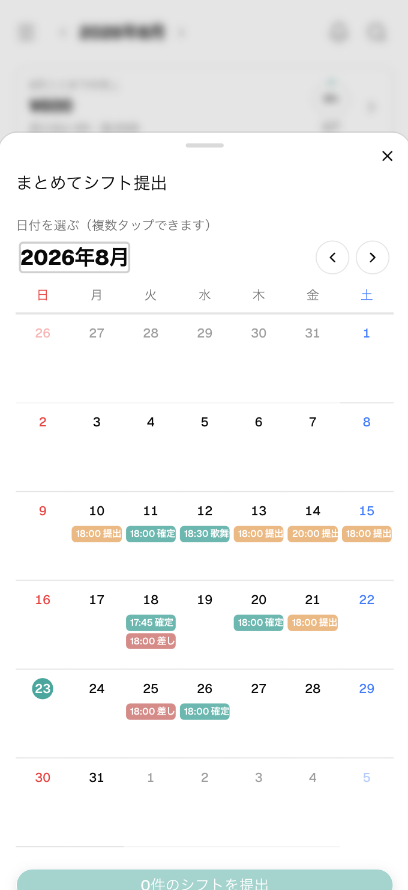
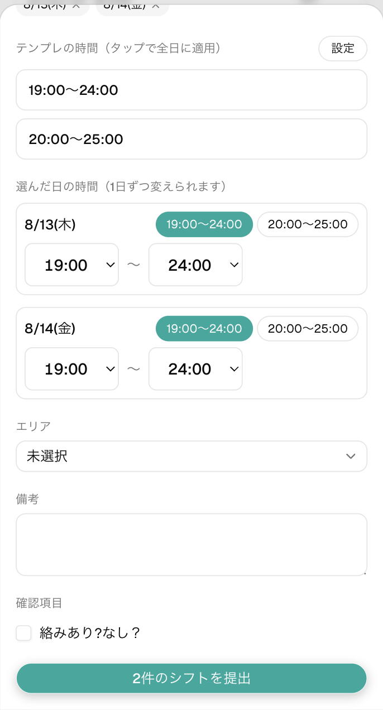
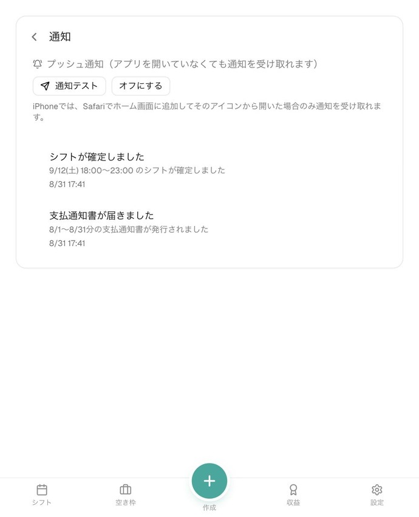

# CalendarApp 使い方説明書

このドキュメントは、CalendarAppを実際に操作するための説明書です。画面のスクリーンショットを使って、管理者側・キャスト側それぞれの主な機能の使い方を順番に説明します。

---

# 管理者側の使い方

## 1. ログイン

ログイン画面で、店舗から発行された **ユーザーID（またはメールアドレス）** と **パスワード** を入力してログインします。

管理者としてログインすると、画面左側にメニュー（ダッシュボード・シフト管理・キャスト管理…）が表示されます。

## 2. ダッシュボード

ログイン後に最初に表示される画面です。今月の状況がひと目で分かるようになっています。

- **今月の売上合計** / **平均1日売上** / **稼働キャスト数**
- **未確定シフト**・**修正申請**・**空き枠申請** の件数（対応が必要な件数がバッジで表示されます）
- **売上推移グラフ**（直近30日）
- **キャスト別売上ランキング**（今月）
- **本日のシフト**

対応待ちの件数（未確定シフトや修正申請の数）は、まずここで確認する習慣をつけると見落としを防げます。

## 3. シフト管理

左メニューの「シフト管理」から、キャストが提出したシフトの確認・確定・差し戻しができます。

- 一覧はリスト表示のほか、右上のボタンで「カレンダー」「タイムライン」表示にも切り替えられます
- **ステータス**列に「提出済み」「確定」「差し戻し」「修正依頼中」などが表示されます
- 内容を確認して問題がなければ「確定」ボタン、修正してほしい場合は「差し戻し」ボタンを押します
- 「修正依頼中」（キャストからの修正申請）が来ている行は「修正申請で対応する」から内容を確認して承認・却下できます
- 上部の絞り込み（全ステータス／全キャスト／全期間）で、対象を絞って確認できます

**ルームの被り防止**: 同じ日時・同じルームで別のキャストのシフトが確定されていると、確定操作がエラーになります（ダブルブッキング防止のための仕組みです）。

## 4. キャスト管理

左メニューの「キャスト管理」から、在籍しているキャストの一覧・登録・編集ができます。

（画像内の本名・連絡先は説明用に隠しています）

- 右上の「キャスト追加」から新規キャストを登録できます（源氏名・本名・報酬率・ログインID・パスワードなどを入力）
- 各行の「編集」から情報を修正、「無効化」から退店処理ができます
- 「コピー」ボタンで、そのキャストのログイン情報（ログインURL・メールアドレス・ログインID・パスワード）をまとめてコピーできます。パスワードは把握していない場合は空欄になります
- 報酬率（%）はキャストごとに個別に設定できます

## 5. エリア管理

左メニューの「エリア管理」から、店舗内のエリア（大まかな区画）を登録・編集できます。

- 右上の「エリア追加」から新規登録できます
- ドラッグハンドル（点6つのアイコン）で表示順を並び替えられます
- 「編集」から名称の変更・無効化ができます
- 店舗設定の「ロケーションモード」でエリアを使わない設定にしている場合、この画面自体を使わないこともあります

## 6. ルーム管理

左メニューの「ルーム管理」から、ルーム（個室・ブースなど）を登録・編集できます。

- 右上の「ルーム追加」から新規登録できます（ルーム名・所属エリア・収容人数・備考）
- 収容人数はシフトの被りチェックに使われます
- 「どこでも可」のような、場所を特定しない特殊なルームを用意しておくこともできます

## 7. 修正申請管理

左メニューの「修正申請」から、キャストから届いたシフト修正申請をまとめて確認・対応できます（シフト管理画面から個別に対応することもできます）。

- 未処理件数が上部に表示されます
- 「現在のシフト」「変更後」「理由」「申請日」を確認できます
- 「承認して確定」で申請内容通りにシフトを確定、「承認してキャンセル」で申請を認めた上でそのシフト自体を取り消し、「却下」で申請を認めず現状維持にできます
- 「シフト管理で見る」から、該当シフトの画面に移動することもできます

## 8. 空き枠管理

左メニューの「空き枠管理」から、店舗側で公開する空き枠（募集シフト）を登録し、キャストからの応募を管理できます。

- 右上の「空き枠追加」から、日付・時間・ルーム・定員を指定して空き枠を公開できます
- 「公開」のスイッチで、キャストへの公開・非公開を切り替えられます
- 公開した空き枠にキャストが応募すると、「申請: キャスト名」の形で一覧に表示されます
- 「承認」を押すとそのキャストのシフトとして登録されます。承認後は「承認を取消」から取り消しもできます

## 9. 売上一覧

左メニューの「売上一覧」から、キャストごとの売上を入力・確認できます。月単位で表示され、上部の「前月」「翌月」で月を移動できます。

- 右上の「追加」から売上を1件ずつ登録、または「まとめて登録」でスプレッドシート形式にまとめて入力できます
- 売上は「手入力」のほか、STRIPCHAT・FC2・DXライブなどプラットフォーム別の入力にも対応しています（入力した数量から自動で円換算されます）
- **為替を一括変更**: チェックボックスで選択した行のうち、為替レートを使って計算した売上を、まとめて新しいレートで再計算できます。過去に誤ったレートで登録してしまった場合の一括修正に使います
- **日払いへの一括変更**: 各行のチェックボックスで複数選択し、まとめて「日払い済み」に変更できます。日払い時の報酬率を上書きする場合、過去に使った数値をテンプレとしてワンタップで選べます

## 10. 支払通知書作成

左メニューの「支払通知書作成」から、期間を指定してキャストへの支払通知書（PDF）を発行できます。

（画像内の本名は説明用に隠しています）

- 上部で対象期間を指定し、「この期間で表示」を押すと一覧が更新されます
- 各キャストの売上合計・報酬率・基本報酬・ボーナス・控除・支払合計が自動計算されます
- 「プレビュー」で実際の支払通知書の内容を確認できます
- チェックボックスで対象を選択し、「選択したN人に発行」を押すと通知書が発行され、対象キャストに通知が届きます
- 一度発行した期間は「発行済み」と表示され、再発行してしまう事故を防げます

## 11. 発行済み支払通知書

左メニューの「発行済み支払通知書」から、過去に発行した通知書を確認・ダウンロードできます。

（画像内の本名は説明用に隠しています）

- 開始日・終了日・キャストで絞り込みができます
- 「開く」から個別の通知書をプレビューでき、その画面の「PDFダウンロード」ボタンでPDFとして保存できます（ファイル名は「対象期間_支払額_本名_支払通知書.pdf」の形式で自動的に付きます）
- チェックボックスで複数選択し、「選択したN件を一括ダウンロード」でまとめてZIPダウンロードできます
- **Google Driveと連携**（画面右上）: 一度連携すると、選択した通知書をGoogle Driveへ直接アップロード保存できます。年・月ごとのフォルダに自動で整理されます

## 12. 通知

左メニューの「通知」から、プッシュ通知の設定やキャストへの通知送信ができます。

- 「プッシュ通知をオンにする」で、アプリを開いていなくても通知を受け取れるようになります
- 「キャストへテスト通知を送信」で、特定のキャストに動作確認用の通知を送れます
- 「シフト提出を促す通知を送る」で、シフト未提出のキャストなどへまとめてリマインドを送れます

## 13. 店舗設定

左メニューの「店舗設定」から、店舗全体の設定を変更できます。

- **店舗情報**: 店舗名・支払通知書等に表示するロゴ
- **デザインテーマ**: 管理画面・キャスト画面の配色テーマ
- **ロケーション設定**: シフト提出時にキャストが選ぶ場所の単位（エリア／ルーム／両方／なし）
- このほか、締切ルール（毎月◯日／毎週◯曜日）、為替レート、プラットフォームごとの換算設定なども、この画面の下部で設定できます

---

# キャスト側の使い方

ここからは、キャスト本人がスマートフォンで使う画面の説明です。画面下部のタブ（シフト／空き枠／作成／収益／設定）で移動します。

## 14. シフト

下部タブの「シフト」で、自分のシフトをカレンダー形式で確認・提出できます。

- 上部に「今月ここまでの売上」と、提出済み・確定件数が表示されます
- カレンダー上の色は凡例の通り（提出済み／確定／差し戻し／修正依頼中）です
- 「時間表示」「金額表示」で、カレンダーに表示する内容を切り替えられます
- 左上のメニューアイコンから、月表示／週表示／日表示／リスト表示の切り替えや、後述の「まとめて追加」、ログアウトができます

### シフトを提出する

下部タブ中央の「作成」ボタンから、シフトを提出できます。カレンダーで提出したい日を複数タップして選択します。

日付を選ぶと、日ごとに時間を設定する画面になります。よく使う時間帯は「テンプレの時間」からタップ一つで全日に適用でき、日によって時間を変えたい場合はその日の項目で個別に変更できます。エリア・備考・店舗が設定した確認項目を入力し、「◯件のシフトを提出」で提出完了です。

## 15. 空き枠

下部タブの「空き枠」で、店舗が公開している空き枠に応募できます。

- 日付・時間・ルームが一覧表示されます
- 「申請する」を押すと管理者に応募が届き、承認されるとシフトとして登録されます

## 16. 収益

下部タブの「収益」で、自分の売上・報酬を確認できます。

- カレンダー表示で日ごとの売上・勤務時間を確認できます（数字＝売上、下段＝勤務時間）
- 上部タブの「レポート」でグラフ形式の集計、「支払通知書」で発行された支払通知書を確認できます
- 目標金額を設定すると、達成率が表示されます

## 17. 設定

下部タブの「設定」で、プロフィールや通知、アプリの見た目を変更できます。

- **プロフィール編集**: 名前・メールアドレス・生年月日（表示するかどうかも選べます）・プロフィール写真
- **着せ替え**: シフト画面や報酬明細の配色を自分好みに変更できます
- 上部の「通知」から、プッシュ通知のオン/オフを設定できます

## 18. 通知（キャスト）

シフトの確定・差し戻しや修正申請の結果などが、通知として届きます。

- 「プッシュ通知をオンにする」を押すと、アプリを開いていなくても通知を受け取れます（iPhoneの場合はSafariでホーム画面に追加し、そのアイコンから開いた場合のみ受信できます）
