# CalendarApp 使い方説明書（管理者向け）

このドキュメントは、店舗の管理者（admin）がCalendarAppを実際に操作するための説明書です。画面のスクリーンショットを使って、主な機能の使い方を順番に説明します。

---

## 1. ログイン

ログイン画面で、店舗から発行された **ユーザーID（またはメールアドレス）** と **パスワード** を入力してログインします。

管理者としてログインすると、画面左側にメニュー（ダッシュボード・シフト管理・キャスト管理…）が表示されます。

## 2. ダッシュボード

ログイン後に最初に表示される画面です。今月の状況がひと目で分かるようになっています。

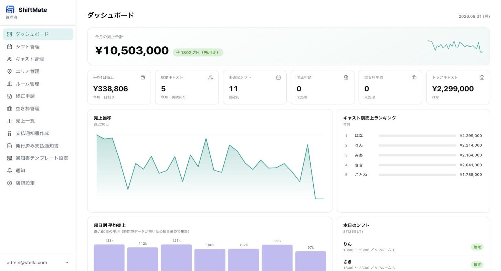

- **今月の売上合計** / **平均1日売上** / **稼働キャスト数**
- **未確定シフト**・**修正申請**・**空き枠申請** の件数（対応が必要な件数がバッジで表示されます）
- **売上推移グラフ**（直近30日）
- **キャスト別売上ランキング**（今月）
- **本日のシフト**

対応待ちの件数（未確定シフトや修正申請の数）は、まずここで確認する習慣をつけると見落としを防げます。

## 3. シフト管理

左メニューの「シフト管理」から、キャストが提出したシフトの確認・確定・差し戻しができます。

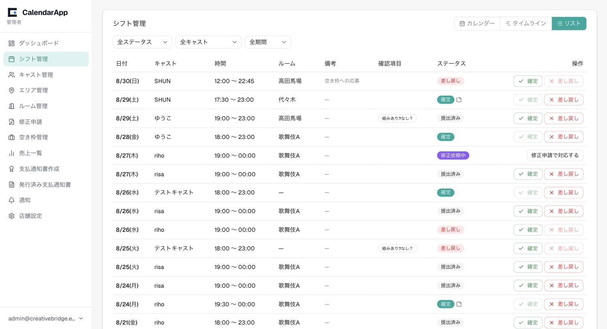

- 一覧はリスト表示のほか、右上のボタンで「カレンダー」「タイムライン」表示にも切り替えられます
- **ステータス**列に「提出済み」「確定」「差し戻し」「修正依頼中」などが表示されます
- 内容を確認して問題がなければ「確定」ボタン、修正してほしい場合は「差し戻し」ボタンを押します
- 「修正依頼中」（キャストからの修正申請）が来ている行は「修正申請で対応する」から内容を確認して承認・却下できます
- 上部の絞り込み（全ステータス／全キャスト／全期間）で、対象を絞って確認できます

**ルームの被り防止**: 同じ日時・同じルームで別のキャストのシフトが確定されていると、確定操作がエラーになります（ダブルブッキング防止のための仕組みです）。

## 4. キャスト管理

左メニューの「キャスト管理」から、在籍しているキャストの一覧・登録・編集ができます。

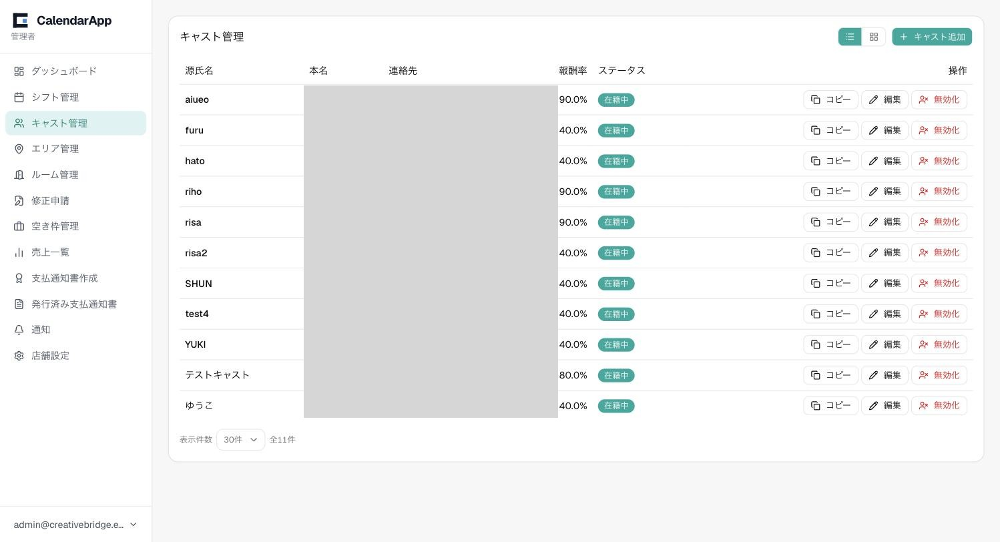

（画像内の本名・連絡先は説明用に隠しています）

- 右上の「キャスト追加」から新規キャストを登録できます（源氏名・本名・報酬率・ログインID・パスワードなどを入力）
- 各行の「編集」から情報を修正、「無効化」から退店処理ができます
- 「コピー」ボタンで、そのキャストのログイン情報（ログインURL・メールアドレス・ログインID・パスワード）をまとめてコピーできます。パスワードは把握していない場合は空欄になります
- 報酬率（%）はキャストごとに個別に設定できます

## 5. 売上一覧

左メニューの「売上一覧」から、キャストごとの売上を入力・確認できます。月単位で表示され、上部の「前月」「翌月」で月を移動できます。

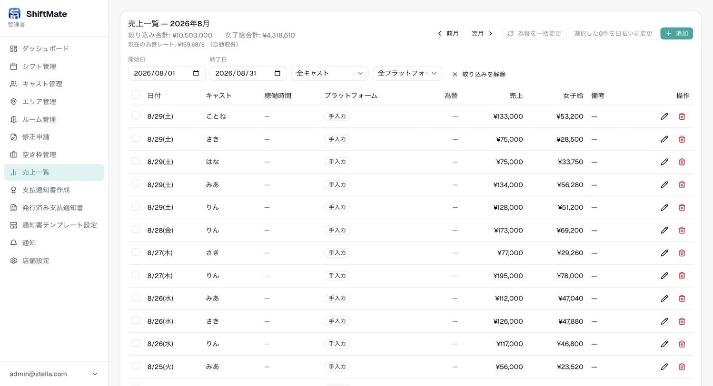

- 右上の「追加」から売上を1件ずつ登録、または「まとめて登録」でスプレッドシート形式にまとめて入力できます
- 売上は「手入力」のほか、STRIPCHAT・FC2・DXライブなどプラットフォーム別の入力にも対応しています（入力した数量から自動で円換算されます）
- **為替を一括変更**: 為替レートを使って計算した売上について、絞り込み条件（期間・キャスト・プラットフォーム）に一致する行をまとめて新しいレートで再計算できます。過去に誤ったレートで登録してしまった場合の一括修正に使います
- **日払いへの一括変更**: 各行のチェックボックスで複数選択し、まとめて「日払い済み」に変更できます。日払い時の報酬率を上書きする場合、過去に使った数値をテンプレとしてワンタップで選べます

## 6. 支払通知書作成

左メニューの「支払通知書作成」から、期間を指定してキャストへの支払通知書（PDF）を発行できます。

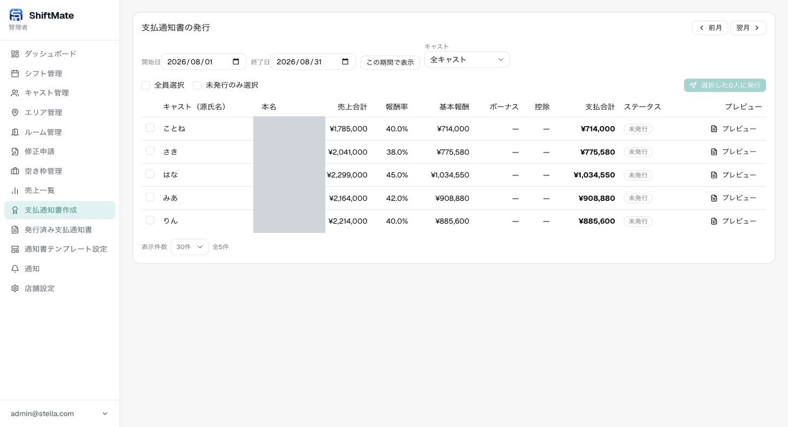

（画像内の本名は説明用に隠しています）

- 上部で対象期間を指定し、「この期間で表示」を押すと一覧が更新されます
- 各キャストの売上合計・報酬率・基本報酬・ボーナス・控除・支払合計が自動計算されます
- 「プレビュー」で実際の支払通知書の内容を確認できます
- チェックボックスで対象を選択し、「選択したN人に発行」を押すと通知書が発行され、対象キャストに通知が届きます
- 一度発行した期間は「発行済み」と表示され、再発行してしまう事故を防げます

## 7. 発行済み支払通知書

左メニューの「発行済み支払通知書」から、過去に発行した通知書を確認・ダウンロードできます。

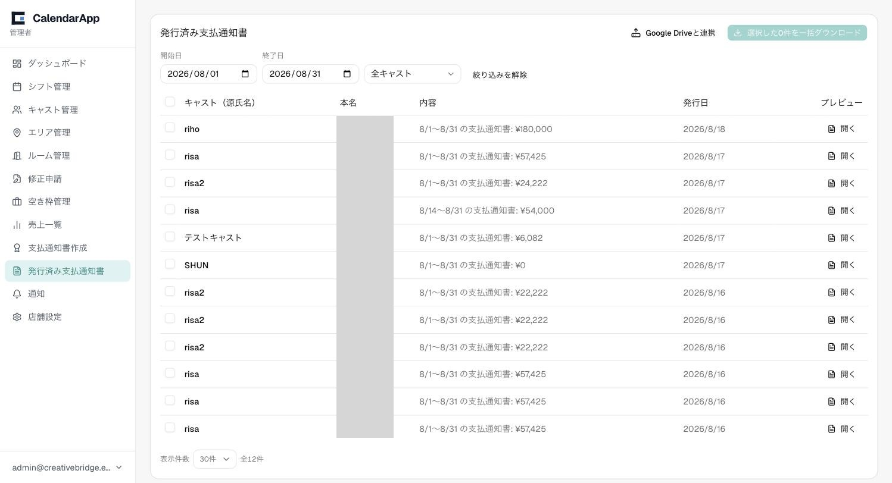

（画像内の本名は説明用に隠しています）

- 開始日・終了日・キャストで絞り込みができます
- 「開く」から個別の通知書をプレビューでき、その画面の「PDFダウンロード」ボタンでPDFとして保存できます（ファイル名は「対象期間_支払額_本名_支払通知書.pdf」の形式で自動的に付きます）
- チェックボックスで複数選択し、「選択したN件を一括ダウンロード」でまとめてZIPダウンロードできます
- **Google Driveと連携**（画面右上）: 一度連携すると、選択した通知書をGoogle Driveへ直接アップロード保存できます。年・月ごとのフォルダに自動で整理されます

## 8. 通知

左メニューの「通知」から、プッシュ通知の設定やキャストへの通知送信ができます。

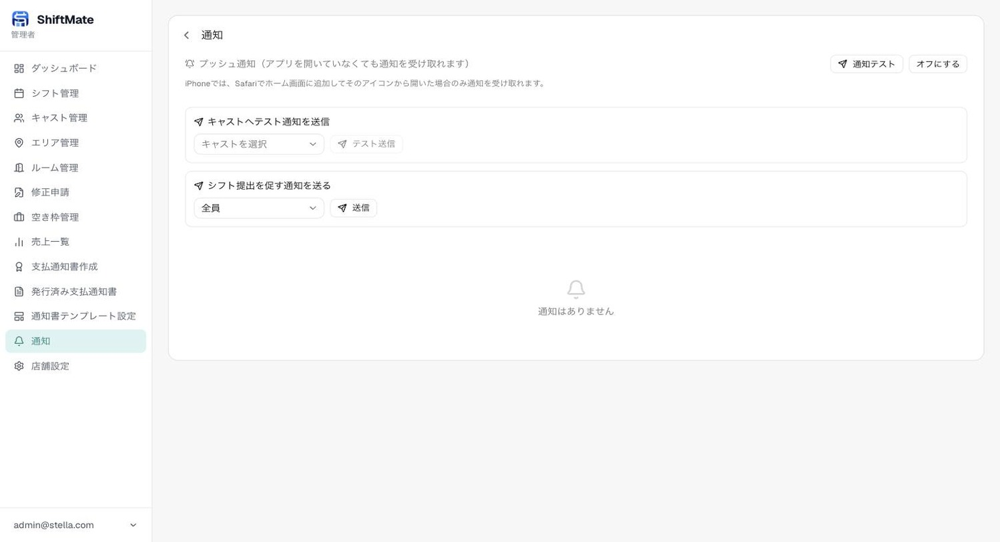

- 「プッシュ通知をオンにする」で、アプリを開いていなくても通知を受け取れるようになります
- 「キャストへテスト通知を送信」で、特定のキャストに動作確認用の通知を送れます
- 「シフト提出を促す通知を送る」で、シフト未提出のキャストなどへまとめてリマインドを送れます

## 9. 店舗設定

左メニューの「店舗設定」から、店舗全体の設定を変更できます。

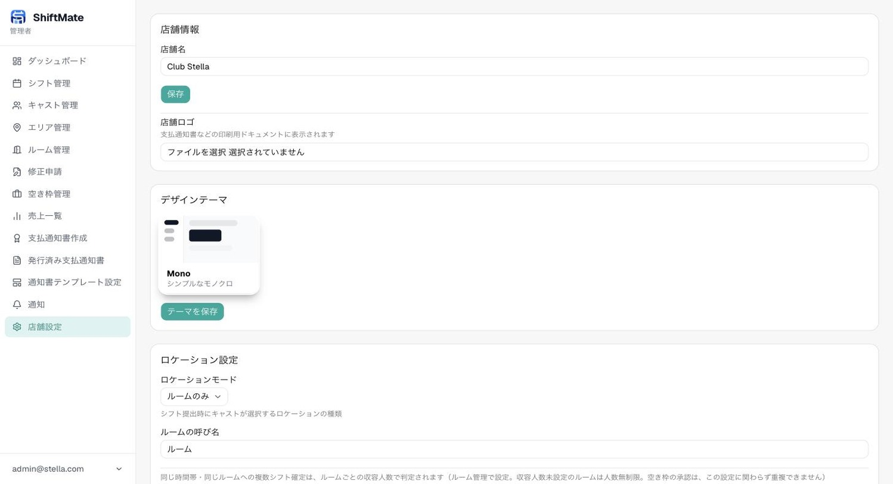

- **店舗情報**: 店舗名・支払通知書等に表示するロゴ
- **デザインテーマ**: 管理画面・キャスト画面の配色テーマ
- **ロケーション設定**: シフト提出時にキャストが選ぶ場所の単位（エリア／ルーム／両方／なし）
- このほか、締切ルール（毎月◯日／毎週◯曜日）、為替レート、プラットフォームごとの換算設定なども、この画面の下部で設定できます

---

# キャスト側の使い方

ここからは、キャスト本人が使う画面の説明です。スマートフォンで開くと、左メニューの代わりに画面下部にタブが表示されますが、内容・操作は同じです。

## 10. シフト

左メニューの「シフト」で、自分のシフトをカレンダー形式で確認・提出できます。

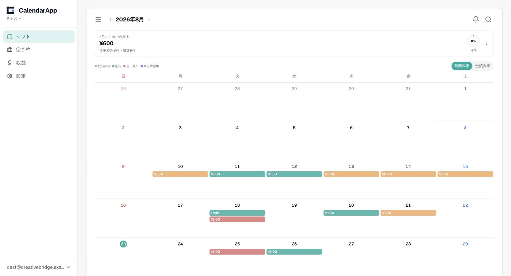

- 上部に「今月ここまでの売上」と、提出済み・確定件数が表示されます
- カレンダー上の色は凡例の通り（提出済み／確定／差し戻し／修正依頼中）です
- 空いている日をタップすると、新しいシフトを提出できます
- 「時間表示」「金額表示」で、カレンダーに表示する内容を切り替えられます

## 11. 空き枠

左メニューの「空き枠」で、店舗が公開している空き枠に応募できます。

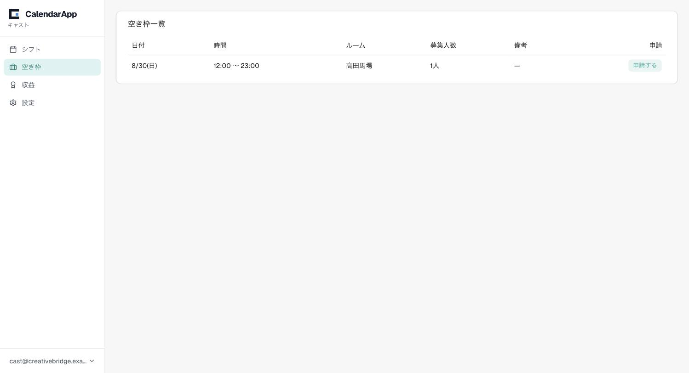

- 日付・時間・ルーム・募集人数が一覧表示されます
- 「申請する」を押すと管理者に応募が届き、承認されるとシフトとして登録されます

## 12. 収益

左メニューの「収益」で、自分の売上・報酬を確認できます。

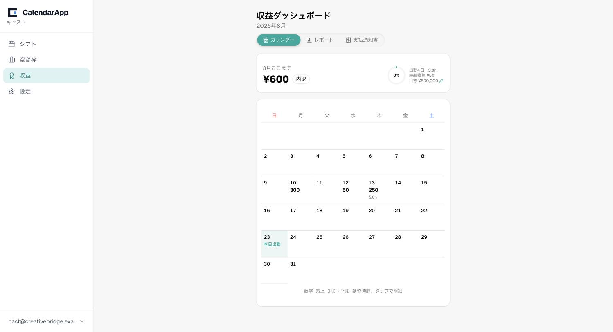

- カレンダー表示で日ごとの売上・勤務時間を確認できます（数字＝売上、下段＝勤務時間）
- 上部タブの「レポート」でグラフ形式の集計、「支払通知書」で発行された支払通知書を確認できます
- 目標金額を設定すると、達成率が表示されます

## 13. 設定

左メニューの「設定」で、プロフィールや通知、アプリの見た目を変更できます。

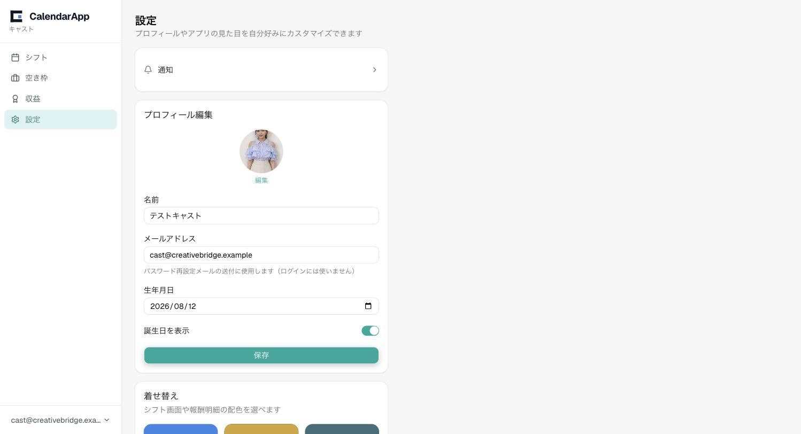

- **プロフィール編集**: 名前・メールアドレス・生年月日（表示するかどうかも選べます）・プロフィール写真
- **着せ替え**: シフト画面や報酬明細の配色を自分好みに変更できます
- 上部の「通知」から、プッシュ通知のオン/オフを設定できます

## 14. 通知（キャスト）

シフトの確定・差し戻しや修正申請の結果などが、通知として届きます。

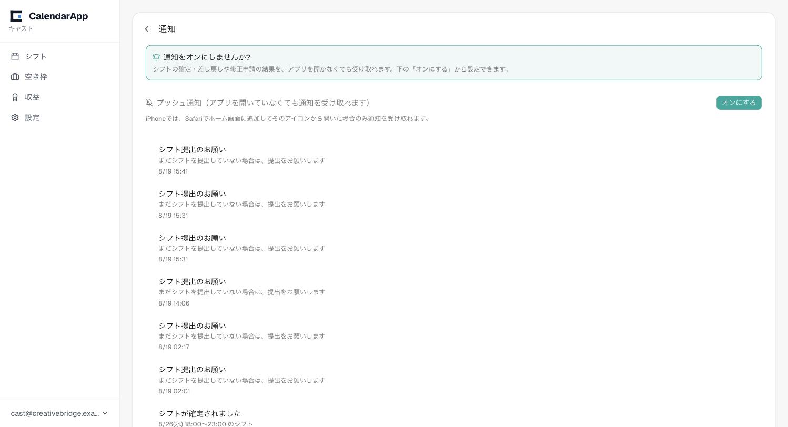

- 「プッシュ通知をオンにする」を押すと、アプリを開いていなくても通知を受け取れます（iPhoneの場合はSafariでホーム画面に追加し、そのアイコンから開いた場合のみ受信できます）
